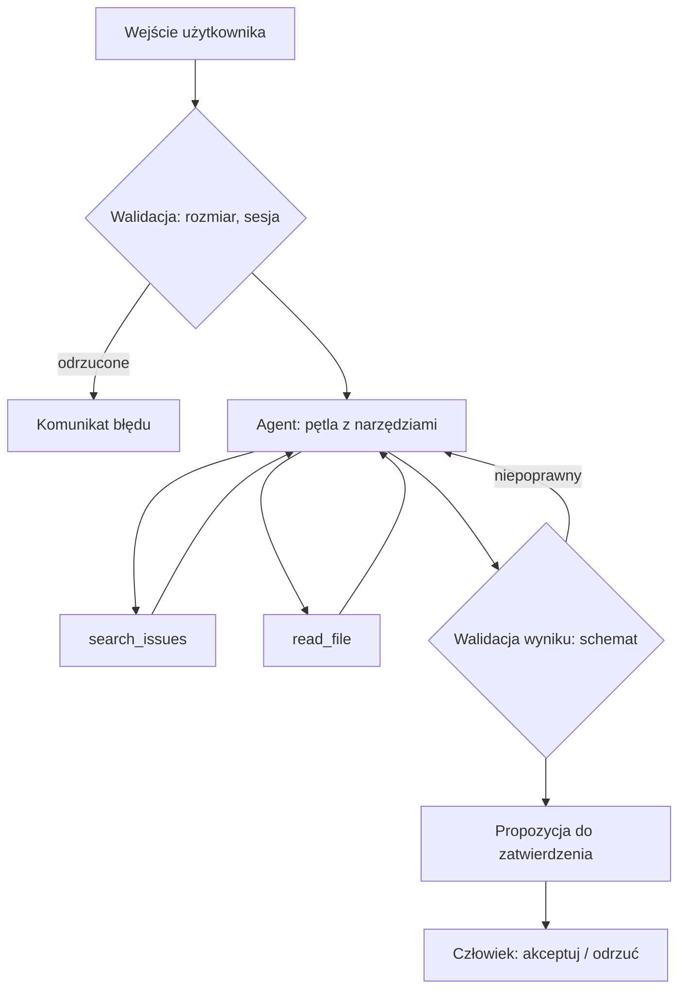

# Moduł 2: Architektura

> ⏱️ Ok. 3 godziny. Pierwszy kod pojawi się dopiero w Module 3.
> 🔒 **Wejście:** `docs/SPEC.md` z Modułu 1.

## O co chodzi

Masz scenariusze, narzędzia i budżety. Teraz decydujesz, **jak to poskładać**: ile jest wywołań modelu, kto decyduje o kolejności kroków, co trafia do kontekstu i jak wyglądają narzędzia od strony modelu.

Najczęstszy błąd na tym etapie to nadmiar: kilku agentów, orkiestrator, pamięć długoterminowa — zanim działa jedna pętla. Zasada tego modułu brzmi: **najprostsza architektura, która przechodzi scenariusze**. Komplikujesz dopiero wtedy, gdy pomiar pokaże, że musisz.

## Cel

Po tym module masz `docs/ARCHITEKTURA.md` zawierający:
- decyzję **workflow / jeden agent / kilku agentów** z uzasadnieniem,
- **diagram** przepływu jednego zadania,
- **kontrakty narzędzi** (nazwa, opis dla modelu, wejście, wyjście, błędy),
- opis tego, **co i kiedy trafia do kontekstu**,
- wybór **stacku i modeli**,
- 3 krótkie **zapisy decyzji** (ADR).

## Kroki

### 1. Wybierz kształt
Przejdź przez scenariusze ze specyfikacji i dla każdego zapisz kroki, które prowadzą do wyniku. Potem porównaj:

| Kształt | Wybierz, gdy | Cena |
|---|---|---|
| **Workflow** — kod steruje kolejnością, model wykonuje pojedyncze kroki | kroki są takie same we wszystkich scenariuszach | najtańszy, najłatwiej testować, mało elastyczny |
| **Jeden agent** — model w pętli sam wybiera narzędzia | kolejność i liczba kroków różni się między scenariuszami | elastyczny, trudniej przewidzieć koszt i zachowanie |
| **Agent + podagenci** — główny agent zleca wydzielone zadania | pojedyncze zadanie nie mieści się rozsądnie w jednym kontekście albo części dają się robić niezależnie | najdroższy, najtrudniejszy do debugowania |

Częsta dobra odpowiedź to **hybryda**: stały szkielet w kodzie (walidacja wejścia → agent → walidacja wyjścia → zapis), a pętla agenta tylko tam, gdzie naprawdę trzeba decydować.

Jeśli wybierasz kilku agentów — zapisz, **jaki pomiar** uzasadni tę decyzję. Jeśli nie umiesz go wskazać, zacznij od jednego. Do tematu wraca moduł [T4: Multi-agent](T4_MULTI_AGENT.md) — celowo dopiero wtedy, gdy masz działającego agenta i ewaluacje, na których da się porównać obie wersje.

### 2. Narysuj przepływ
Jeden diagram dla najważniejszego scenariusza. Mermaid renderuje się bezpośrednio na GitHubie:

````markdown

````

Zaznacz na diagramie trzy rzeczy: gdzie jest **limit kroków**, gdzie **człowiek** i gdzie wynik jest **walidowany** kodem, a nie wiarą w model.

### 3. Zaprojektuj kontrakty narzędzi
Model widzi narzędzie wyłącznie przez nazwę, opis i schemat wejścia. To jest interfejs użytkownika dla modelu — pisz go równie starannie jak API dla człowieka.

```markdown
### search_issues
**Opis dla modelu:** Szuka w otwartych i zamkniętych zgłoszeniach repozytorium.
Użyj przed zaproponowaniem etykiety `duplicate`. Zwraca najwyżej 10 wyników.
**Wejście:** { query: string (słowa kluczowe, nie całe zdanie), state: "open" | "closed" | "all" }
**Wyjście:** [{ number, title, state, excerpt (do 300 znaków) }]
**Błędy:** zwracane jako dane: { error: "rate_limited", retry_after_s: 30 }
**Uprawnienia:** tylko odczyt
```

Zasady, które oszczędzają najwięcej czasu:
- **Mało narzędzi, wyraźnie różnych.** Dwa narzędzia o podobnym opisie model będzie mylił.
- **Opis mówi, kiedy użyć** — nie tylko co narzędzie robi.
- **Wynik jest krótki.** Narzędzie, które zwraca 50 000 znaków, zjada kontekst i budżet. Przycinaj, stronicuj, zwracaj identyfikatory zamiast całych treści.
- **Błąd wraca jako dane**, które model może przeczytać i na które może zareagować — nie jako wyjątek urywający pętlę.
- **Uprawnienia egzekwuje kod narzędzia**, nie prompt. „Nie usuwaj niczego" w instrukcji to prośba; brak narzędzia do usuwania to gwarancja.

Jeśli narzędzie, którego potrzebujesz, istnieje już jako serwer MCP (Model Context Protocol) — możesz go użyć zamiast pisać własne. Zapisz wtedy, **które** z jego narzędzi udostępniasz agentowi; rzadko potrzebne są wszystkie.

> 🧩 Dwie decyzje architektoniczne mają własne moduły techniczne. Jeśli agent działa na **cudzych systemach** w imieniu użytkownika — zajrzyj do [T1: Integracje](T1_INTEGRACJE.md), zanim zamkniesz kontrakty narzędzi. Jeśli ma działać **bez otwartej przeglądarki** — przeczytaj krok 1 z [T2: Praca w tle](T2_PRACA_W_TLE.md), bo wybór wzorca zmienia diagram.

### 4. Zaplanuj kontekst
Kontekst to wszystko, co model dostaje przy danym wywołaniu. Jest ograniczony, płatny, a jego jakość decyduje o jakości odpowiedzi. Rozpisz go:

| Składnik | Skąd | Kiedy | Szacowany rozmiar |
|---|---|---|---|
| instrukcje systemowe | plik w repo | zawsze | ~600 tokenów |
| opisy narzędzi | kod | zawsze | ~400 tokenów |
| wiadomość użytkownika | wejście | zawsze | do limitu ze specyfikacji |
| wyniki narzędzi | pętla | narastają z każdym krokiem | **największa pozycja** |
| historia rozmowy | baza | jeśli agent jest konwersacyjny | rośnie bez końca, jeśli jej nie przytniesz |
| wiedza z dokumentów | wyszukiwanie | na żądanie, przez narzędzie | top-k fragmentów |

Dla każdej pozycji, która rośnie, zapisz, **co ją ogranicza**: przycinanie historii, limit wyników narzędzia, streszczanie.

Zdecyduj też o pamięci: co agent pamięta **w ramach jednego zadania**, co **między zadaniami** i czy to drugie jest w ogóle potrzebne w pierwszej wersji (zwykle nie).

### 5. Wybierz stack i modele
Masz dwie drogi:

- **Stack kursowy** — Next.js, Vercel AI SDK, OpenRouter, Supabase. Możesz zacząć od gotowego startera: `git clone https://github.com/SirIdontCare/starter-agent-s2.git`. Dostajesz logowanie, bazę, RAG i działającą pętlę z narzędziami; usuwasz to, czego Twój agent nie potrzebuje.
- **Własny stack** — dowolny język i framework. Dobry wybór, jeśli agent ma żyć w istniejącym systemie albo znasz inny ekosystem lepiej. Trzy przykłady w Pythonie są w [dodatkach](dodatki/).

W obu przypadkach modele bierzesz z OpenRoutera kluczem kursowym. Zapisz, **który model do czego**:

| Rola | Model | Dlaczego |
|---|---|---|
| główna pętla agenta | … | musi dobrze wywoływać narzędzia |
| proste kroki (klasyfikacja, ekstrakcja) | najtańszy z tabeli | nie potrzebują mocnego modelu |
| sędzia w ewaluacjach (Moduł 4) | … | inny niż oceniany, jeśli to możliwe |

Nazwy modeli trzymaj w konfiguracji, nie w kodzie — będziesz je zmieniał.

### 6. Zapisz trzy decyzje
ADR (Architecture Decision Record) to pół strony: kontekst, decyzja, odrzucone alternatywy, konsekwencje. Zapisz trzy najważniejsze wybory z tego modułu — na przykład kształt, stack i sposób zatwierdzania akcji.

```markdown
## ADR-1: Jeden agent zamiast workflow
**Kontekst:** w scenariuszach S1–S4 liczba wyszukiwań zależy od wyników poprzednich.
**Decyzja:** jedna pętla agenta z limitem 8 kroków, w stałym szkielecie walidacji.
**Odrzucone:** workflow o 3 stałych krokach — nie obsługuje S4 (wymaga dopytania).
**Konsekwencje:** koszt zadania jest zmienny; potrzebny pomiar w Module 4.
```

## ✅ Dowód „done"

W repo jest `docs/ARCHITEKTURA.md`, w którym:
- jest diagram z zaznaczonym limitem kroków, człowiekiem i walidacją wyniku,
- każde narzędzie ze specyfikacji ma kontrakt z opisem dla modelu i formatem błędu,
- tabela kontekstu wskazuje, co ogranicza każdą rosnącą pozycję,
- są 3 ADR-y, każdy z odrzuconą alternatywą.

## 🤖 Sprawdź się przez AI

> *„Oto specyfikacja i architektura agenta AI: [wklej oba]. Oceń jak architekt, który widział dużo przekombinowanych systemów — PASS/FAIL + jedno zdanie:*
> *1. Czy wybrany kształt (workflow / agent / kilku agentów) jest najprostszym, który obsłuży scenariusze?*
> *2. Czy opisy narzędzi mówią modelowi, KIEDY ich użyć, i czy żadne dwa się nie pokrywają?*
> *3. Czy uprawnienia są egzekwowane w kodzie narzędzi, a nie tylko w instrukcjach?*
> *4. Czy coś w kontekście może rosnąć bez ograniczenia?*
> *5. Którą część tej architektury usunąłbyś z pierwszej wersji?"*

## 🚀 Idź dalej (nieobowiązkowe)

1. **Przejdź scenariusz na sucho.** Weź S1 i odegraj pętlę ręcznie: jakie narzędzie, z jakim wejściem, co wraca, co dalej. Zapisz, ile kroków i ile tekstu trafiło do kontekstu.
2. **Zaprojektuj wariant bez agenta.** Narysuj, jak wyglądałby ten sam system jako sztywny workflow. Które scenariusze by nie przeszły? To Twoje najlepsze uzasadnienie architektury.
3. **Przeczytaj cudzy kontrakt.** Znajdź opis narzędzi dowolnego publicznego serwera MCP i oceń go według zasad z kroku 3.
