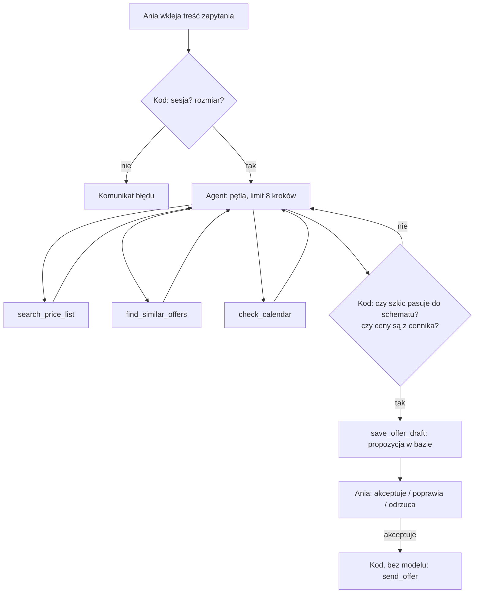

# Moduł 2: Architektura

> ⏱️ Ok. 3 godziny. Nadal nie piszesz kodu — pierwszy pojawi się w Module 3.
> Potrzebujesz: `docs/BRIEF.md` z [Modułu 0](M0_BRIEF.md) i `docs/SPEC.md` z [Modułu 1](M1_SPECYFIKACJA.md).

## O co chodzi

Masz już ustalone, **co** agent ma robić: scenariusze, narzędzia, granice. Teraz decydujesz, **jak to poskładać**.

Wróćmy do remontu. Brief był kartką z ustaleniami, specyfikacja — listą pomieszczeń i wymagań. Architektura to **projekt instalacji**: którędy idą rury, gdzie są bezpieczniki, z jakich materiałów budujesz. Tego nie widać w gotowym mieszkaniu, ale to od tego zależy, czy za rok coś zaleje sąsiada.

W agencie „instalacja" to pięć decyzji:

1. **Z czego budujesz** — technologie (stack).
2. **Kto steruje** — Twój kod czy model.
3. **Jak wyglądają narzędzia** od strony modelu.
4. **Co model widzi** przy każdym wywołaniu.
5. **Jakich modeli** używasz i do czego.

Najczęstszy błąd na tym etapie to przesada: kilku agentów, pamięć długoterminowa, osobna baza wektorowa — zanim działa jedna prosta pętla. Zasada tego modułu: **najprostsza architektura, która przechodzi Twoje scenariusze**. Komplikujesz dopiero wtedy, gdy pomiar pokaże, że musisz.

## Po tym module masz

- plik `docs/ARCHITEKTURA.md`,
- wybrany stack, z uzasadnieniem,
- diagram drogi jednego zadania przez system,
- opis każdego narzędzia w formie, w jakiej zobaczy je model,
- trzy krótkie zapisy najważniejszych decyzji.

## Słowa, które tu padną

| Słowo | Co to znaczy | Porównanie z życia |
|---|---|---|
| **Architektura** | sposób, w jaki części systemu są ułożone i połączone | projekt instalacji w mieszkaniu |
| **Stack** | zestaw technologii, z których budujesz | zestaw narzędzi i materiałów ekipy |
| **Pętla agenta** | model myśli → wywołuje narzędzie → czyta wynik → myśli dalej, aż skończy | kucharz: sprawdza lodówkę, kroi, próbuje, doprawia |
| **Workflow** | stała sekwencja kroków zapisana w kodzie | przepis: zawsze te same czynności po kolei |
| **Podagent** | osobny agent, któremu główny agent zleca część pracy | pomocnik, któremu szef kuchni mówi „obierz warzywa i daj znać" |
| **Kontekst** | wszystko, co model dostaje przy jednym wywołaniu: instrukcje, rozmowa, wyniki narzędzi | wszystkie kartki, które leżą przed kimś na biurku |
| **Token** | kawałek tekstu, w którym liczy się długość i cenę; ok. 3–4 znaki | impuls w starej taryfie telefonicznej |
| **Kontrakt narzędzia** | nazwa, opis, co przyjmuje i co zwraca | instrukcja obsługi urządzenia, napisana dla modelu |
| **Schemat** | precyzyjny opis kształtu danych: jakie pola, jakiego typu | formularz z rubrykami |
| **Walidacja** | sprawdzenie kodem, czy dane pasują do schematu | urzędnik sprawdzający, czy formularz jest kompletny |
| **MCP** | standard, w którym usługa wystawia gotowe narzędzia dla agentów | znormalizowane gniazdko: jeden wtyk, wiele urządzeń |
| **ADR** | pół strony o jednej decyzji: co wybrałem, co odrzuciłem i dlaczego | notatka „dlaczego kupiliśmy to auto, a nie tamto" |

## Polecany stack

Jeśli nie masz mocnego powodu, żeby wybrać inaczej — **weź ten**. To te same technologie, których używasz na kursie głównym, więc nie uczysz się niczego od zera, a wszystkie moduły tej ścieżki pokazują przykłady właśnie w nim.

| Warstwa | Polecane | Do czego służy | Dlaczego to |
|---|---|---|---|
| **Aplikacja** | Next.js + TypeScript | interfejs i serwer w jednym projekcie | znasz z kursu; jedno wdrożenie zamiast dwóch |
| **Pętla agenta i narzędzia** | Vercel AI SDK | wywołania modelu, narzędzia, strumieniowanie odpowiedzi | znasz z kursu; ma gotową pętlę z limitem kroków |
| **Dostęp do modeli** | OpenRouter (klucz LABA) | jeden klucz do wielu modeli | zmiana modelu to zmiana jednej zmiennej |
| **Schematy i walidacja** | `zod` | opis wejścia narzędzi i kształtu wyniku | standard w tym ekosystemie; już jest w projekcie |
| **Baza danych** | Supabase (Postgres) | dane aplikacji, rozmowy, ślady przebiegów, zadania | znasz z kursu; darmowy plan wystarcza |
| **Logowanie** | Supabase Auth | konta użytkowników i sesje | znasz z Lekcji 7; nie piszesz własnego logowania |
| **Wyszukiwanie w dokumentach** | `pgvector` w tej samej bazie | RAG | znasz z Lekcji 6; nie potrzebujesz osobnej bazy wektorowej |
| **Ewaluacje** | własny skrypt w TypeScripcie | testy agenta ([Moduł 4](M4_EWALUACJE.md)) | 100–200 linii; żadnego nowego narzędzia do nauki |
| **Ślady przebiegów** | dwie tabele w Supabase | co agent zrobił, ile to trwało i kosztowało ([Moduł 7](M7_WDROZENIE.md)) | widzisz dokładnie to, co sam zapisałeś |
| **Zadania w tle** | Supabase Cron i Queues | harmonogram i kolejka ([T2](T2_PRACA_W_TLE.md)) | w tej samej bazie; nic nowego do postawienia |
| **Wdrożenie** | Vercel | adres w internecie | znasz z kursu; darmowy plan wystarcza |
| **Płatności** | Stripe, tryb testowy | subskrypcje ([T5](T5_PLATNOSCI_STRIPE.md)) | najlepsza dokumentacja i środowisko testowe |

**Najszybszy start:** gotowy projekt z tym stackiem — logowanie, baza, RAG i działająca pętla z narzędziami:

```bash
git clone https://github.com/SirIdontCare/starter-agent-s2.git moj-agent
```

W Module 3 usuniesz z niego to, czego Twój agent nie potrzebuje.

### Kiedy wybrać inny stack

| Sytuacja | Co wtedy |
|---|---|
| Agent ma działać **wewnątrz istniejącego systemu** (firmowa aplikacja w innym języku) | buduj w technologii tego systemu; modele nadal przez OpenRouter |
| Na co dzień piszesz w **Pythonie** i w nim jesteś szybszy | FastAPI + Pydantic AI + Postgres; przykłady w [dodatkach](dodatki/PYTHON_1_FASTAPI.md) |
| Agent to **narzędzie w terminalu** albo skrypt, bez interfejsu w przeglądarce | sam Node.js albo Python, bez Next.js |
| Potrzebujesz biblioteki, która istnieje tylko w jednym ekosystemie (np. analiza danych) | ten ekosystem dla tej części; reszta może zostać |

Powód „bo chcę się nauczyć czegoś nowego" jest uczciwy, ale policz koszt: uczysz się wtedy **dwóch** rzeczy naraz — projektowania agenta i nowej technologii — i trudniej będzie odróżnić, która z nich sprawia kłopot.

### Czego na start nie polecam

| Pokusa | Dlaczego nie teraz |
|---|---|
| Framework do „zespołów agentów" od pierwszego dnia | dodaje warstwę, której nie rozumiesz, zanim rozumiesz jedną pętlę; do tematu wraca [T4](T4_MULTI_AGENT.md) |
| Osobna baza wektorowa | `pgvector` w Twojej bazie wystarcza na dziesiątki tysięcy fragmentów |
| Własny system logowania | łatwo o dziurę; Supabase Auth masz gotowe |
| Mikroserwisy, osobny backend „na zapas" | jeden projekt łatwiej wdrożyć, śledzić i naprawić |
| Platforma do obserwowalności przed pierwszym użytkownikiem | dwie tabele dają to samo i uczą, co jest w śladzie |
| Najmocniejszy model „żeby na pewno działało" | maskuje błędy w opisach narzędzi i kosztuje wielokrotnie więcej |

<details>
<summary>🔬 Głębiej: gdzie polecany stack ma słabe strony</summary>

Żaden wybór nie jest darmowy. Warto znać ograniczenia tego stacku, zanim się na nie natkniesz:

- **Limit czasu funkcji.** Na darmowym planie Vercela jedno wywołanie funkcji może trwać do 300 sekund. Agent z długą pętlą albo wolnymi narzędziami potrafi go przekroczyć. Rozwiązaniem jest praca w tle ([T2](T2_PRACA_W_TLE.md)), a nie mocniejszy plan.
- **Szybkie tempo zmian w SDK.** Biblioteki agentowe zmieniają nazwy funkcji między głównymi wersjami. Dlatego w tej ścieżce każdy prompt każe asystentowi sprawdzić dokumentację zainstalowanej wersji, zamiast pisać z pamięci. Przypnij wersje w `package.json` i aktualizuj świadomie.
- **Jedna baza do wszystkiego.** Dane aplikacji, wektory, kolejka i ślady w jednym Postgresie to wygoda, ale też wspólny punkt awarii i wspólny limit. Dla projektu tej skali to dobry kompromis; przy dużym ruchu ślady i kolejka wynoszą się jako pierwsze.
- **Pośrednik między Tobą a modelem.** OpenRouter upraszcza zmianę modeli, ale dodaje jedno ogniwo: własne limity, własne awarie, niewielkie opóźnienie. Część funkcji specyficznych dla dostawców bywa dostępna z opóźnieniem albo w innym kształcie.
- **Python ma bogatszy ekosystem wokół danych i ewaluacji.** Jeśli Twój agent dużo liczy albo przetwarza dokumenty w nietypowych formatach, policz, ile bibliotek będziesz zastępować własnym kodem.

Uczciwe kryterium wyboru stacku to nie „który jest najlepszy", tylko: **w którym najszybciej zobaczę, co mój agent robi źle**. Zwykle jest to ten, który znasz najlepiej.

</details>

## Przykład: Ofertownik

Tak wygląda gotowy `docs/ARCHITEKTURA.md` naszego przykładu (skrócony):

````markdown
# Architektura: Ofertownik

## Stack
Polecany stack kursowy, start ze startera. Powód: nic nie wymaga innego,
a cennik i archiwum ofert mieszczą się w Postgresie z pgvector.

## Kształt
Jeden agent w pętli, w stałym szkielecie kodu. Bez podagentów.

## Droga jednego zadania



## Narzędzia
(pełne kontrakty niżej)
- search_price_list — odczyt
- find_similar_offers — odczyt
- check_calendar — odczyt
- save_offer_draft — zapis propozycji we własnej bazie
- send_offer — NIE jest narzędziem agenta; wykonuje je kod po akceptacji Ani

## Kontekst
| Składnik | Kiedy | Rozmiar | Co go ogranicza |
|---|---|---|---|
| instrukcje systemowe | zawsze | ~500 tokenów | stały plik |
| opisy 4 narzędzi | zawsze | ~400 tokenów | stała liczba narzędzi |
| treść zapytania | zawsze | do 6 000 znaków | limit wejścia w kodzie |
| wyniki search_price_list | na żądanie | do 5 pozycji | limit w narzędziu |
| wyniki find_similar_offers | na żądanie | do 3 ofert, po 800 znaków | limit i przycinanie w narzędziu |

## Modele
| Rola | Model | Dlaczego |
|---|---|---|
| pętla agenta | średni z tabeli kursowej | musi dobrze wybierać narzędzia |
| sędzia w ewaluacjach | najtańszy, inny niż oceniany | proste pytania tak/nie |

## Decyzje

### ADR-1: Jeden agent zamiast stałego workflow
Kontekst: w S1 wystarcza jedno wyszukanie, w S4 potrzeba kilku i pytań do klienta.
Decyzja: jedna pętla z limitem 8 kroków w stałym szkielecie walidacji.
Odrzucone: workflow „szukaj → pisz" — nie obsłuży S4 ani S5.
Skutek: koszt zadania jest zmienny, trzeba go mierzyć.

### ADR-2: Wysyłka poza modelem
Kontekst: wysłanej oferty nie da się cofnąć.
Decyzja: agent zapisuje tylko szkic; wysyła zwykły kod po kliknięciu Ani.
Odrzucone: narzędzie send_offer z instrukcją „użyj tylko po zgodzie".
Skutek: model nie ma technicznej możliwości wysłania czegokolwiek.

### ADR-3: Cena sprawdzana kodem
Kontekst: zmyślona cena to najgorszy możliwy błąd.
Decyzja: po wygenerowaniu szkicu kod porównuje każdą cenę z cennikiem.
Odrzucone: zdanie w instrukcjach „nigdy nie zmyślaj cen".
Skutek: jedno dodatkowe sprawdzenie na szkic, zero cen spoza cennika.
````

## Kroki

### Krok 1 — Wybierz stack

**Po co:** bo wszystkie dalsze decyzje i wszystkie prompty zależą od tego, w czym budujesz.

**Co robisz:** przeczytaj sekcję „Polecany stack" powyżej i odpowiedz na jedno pytanie: **czy mam konkretny powód, żeby wybrać inaczej?** Jeśli nie — bierzesz polecany. Jeśli tak — zapisz ten powód jednym zdaniem.

**Prompt do asystenta:**

```text
Przeczytaj docs/BRIEF.md i docs/SPEC.md.

Rozważam budowę tego agenta w stacku: Next.js + TypeScript, Vercel AI SDK,
OpenRouter, Supabase (Postgres, Auth, pgvector), Vercel.

Odpowiedz krótko:
1. Czy któryś scenariusz albo narzędzie ze specyfikacji jest w tym stacku
   trudne lub niemożliwe? Jeśli tak — które i dlaczego.
2. Czy widzisz powód, żeby wybrać inny stack? Podaj tylko powody
   wynikające z moich dokumentów, nie ogólne preferencje.
3. Czego z gotowego startera (czat, RAG, logowanie, generowanie obrazów,
   wyszukiwanie w sieci) mój agent NIE będzie potrzebował?

Niczego nie twórz i nie zmieniaj w plikach.
```

**Gotowe, gdy:** masz zapisane jedno zdanie: „Buduję w … ponieważ …".

### Krok 2 — Zdecyduj, kto steruje: kod czy model

**Po co:** od tego zależy koszt, przewidywalność i to, jak trudno będzie znaleźć błąd.

**Co robisz:** weź scenariusze ze specyfikacji. Dla każdego wypisz kroki, które prowadzą do wyniku. Potem porównaj listy.

| Co widzisz | Kształt | Co to znaczy w praktyce |
|---|---|---|
| kroki są **takie same** we wszystkich scenariuszach | **workflow** | piszesz kolejność w kodzie; model wykonuje pojedyncze kroki. Najtaniej i najłatwiej testować |
| liczba i kolejność kroków **różni się** między scenariuszami | **jeden agent** | model w pętli sam wybiera narzędzia. Elastycznie, ale koszt i zachowanie są mniej przewidywalne |
| jedno zadanie **nie mieści się** w jednym kontekście albo ma niezależne części | **agent z podagentami** | najdrożej i najtrudniej; wracamy do tego w [T4](T4_MULTI_AGENT.md) |

W Ofertowniku S1 to jedno wyszukanie, a S4 — kilka wyszukiwań i pytania do klienta. Listy kroków są różne, więc: jeden agent.

Najczęstsza dobra odpowiedź to **połączenie**: stały szkielet w kodzie, a pętla agenta tylko w środku.

```
kod: sprawdź sesję i rozmiar wejścia
  → agent: pętla z narzędziami (tu decyduje model)
kod: sprawdź, czy wynik pasuje do schematu
kod: zapisz propozycję
człowiek: zatwierdź
kod: wykonaj akcję
```

Wszystko, co da się zapisać jako zwykły kod, zapisz jako zwykły kod. Modelowi zostaw tylko to, czego nie umiesz ująć regułą.

**Prompt do asystenta:**

```text
Przeczytaj docs/SPEC.md.

Dla każdego scenariusza wypisz w punktach kroki, które agent musiałby wykonać,
żeby dojść do oczekiwanego wyniku (które narzędzie, po co, co dalej).

Potem porównaj te listy i odpowiedz:
1. Czy kolejność i liczba kroków jest taka sama we wszystkich scenariuszach?
2. Które kroki są ZAWSZE takie same i mogą być zwykłym kodem
   (np. sprawdzenie sesji, walidacja wyniku, zapis)?
3. W którym miejscu naprawdę potrzebna jest decyzja modelu?

Zaproponuj najprostszy kształt: workflow, jeden agent albo agent w stałym
szkielecie kodu. Nie proponuj kilku agentów, chyba że wskażesz scenariusz,
który bez tego się nie uda.
Niczego nie twórz w plikach.
```

**Gotowe, gdy:** umiesz powiedzieć jednym zdaniem, w którym miejscu decyduje model, a w których — Twój kod.

### Krok 3 — Narysuj drogę jednego zadania

**Po co:** rysunek od razu pokazuje dziury: brak miejsca, w którym ktoś sprawdza wynik, albo strzałkę prowadzącą prosto do nieodwracalnej akcji.

**Co robisz:** narysuj jeden diagram dla najważniejszego scenariusza. Użyj Mermaid — to tekst, który GitHub sam zamienia na rysunek (przykład masz w sekcji o Ofertowniku).

Na diagramie muszą być widoczne trzy rzeczy:

| Co | Dlaczego |
|---|---|
| **limit kroków** pętli | bez niego agent może kręcić się w kółko i palić pieniądze |
| **miejsce, w którym kod sprawdza wynik** | „model zwykle robi dobrze" to nie jest zabezpieczenie |
| **człowiek** przed każdą akcją, której nie da się cofnąć | to wynika wprost ze specyfikacji |

**Prompt do asystenta:**

```text
Przeczytaj docs/SPEC.md. Narysuj w Mermaid (flowchart TD) drogę jednego zadania
dla scenariusza S1, od wejścia użytkownika do końcowego wyniku.

Diagram ma pokazywać:
- sprawdzenie sesji i rozmiaru wejścia przez kod, zanim cokolwiek trafi do modelu,
- pętlę agenta z zaznaczonym limitem kroków,
- każde narzędzie ze specyfikacji jako osobny element,
- miejsce, w którym kod sprawdza wynik (schemat, dozwolone wartości),
- człowieka przed każdą akcją oznaczoną w specyfikacji jako nieodwracalna.

Zapisz diagram w docs/ARCHITEKTURA.md w sekcji „Droga jednego zadania".
Jeśli plik nie istnieje, utwórz go z samym tytułem i tą sekcją.
```

**Gotowe, gdy:** diagram renderuje się na GitHubie i umiesz na nim pokazać palcem limit kroków, sprawdzenie wyniku i człowieka.

### Krok 4 — Opisz narzędzia tak, jak zobaczy je model

**Po co:** model nie widzi kodu Twojego narzędzia. Widzi tylko jego **nazwę, opis i listę pól do wypełnienia**. Na tej podstawie decyduje, czy i kiedy go użyć. Słaby opis to najczęstsza przyczyna tego, że agent „nie wie", co robić.

**Co robisz:** dla każdego narzędzia ze specyfikacji napisz kontrakt:

```markdown
### search_price_list
**Opis dla modelu:** Szuka szkoleń w cenniku firmy. Użyj ZAWSZE, zanim podasz
jakąkolwiek cenę — ceny wolno brać wyłącznie stąd. Zwraca najwyżej 5 pozycji.
**Wejście:** { query: string — 2–4 słowa kluczowe, np. "Excel podstawy", nie całe zdanie }
**Wyjście:** [{ id, nazwa, czas_trwania, cena_za_osobe, cena_grupowa, min_osob }]
**Gdy nic nie znajdzie:** { wyniki: [], wskazowka: "Spróbuj ogólniejszego hasła" }
**Gdy coś się zepsuje:** { blad: "baza_niedostepna" }
**Uprawnienia:** tylko odczyt
```

Pięć zasad, które oszczędzają najwięcej czasu:

| Zasada | ❌ Źle | ✅ Dobrze |
|---|---|---|
| **Opis mówi, KIEDY użyć**, nie tylko co robi | „Wyszukuje w cenniku." | „Użyj zawsze, zanim podasz cenę." |
| **Mało narzędzi, wyraźnie różnych** | `search_prices` i `find_price` | jedno `search_price_list` |
| **Wynik jest krótki** | cały cennik, 40 000 znaków | 5 najlepiej pasujących pozycji |
| **Błąd wraca jako informacja**, którą model może przeczytać | program się wywraca | `{ blad: "baza_niedostepna" }` |
| **Uprawnień pilnuje kod**, nie prośba w instrukcji | „Nie wysyłaj bez zgody." | agent w ogóle nie ma narzędzia do wysyłania |

Ostatnia zasada jest najważniejsza. Zdanie w instrukcji to prośba. Brak narzędzia to gwarancja.

Jeśli usługa, z którą chcesz się połączyć, udostępnia gotowy serwer MCP, możesz użyć jego narzędzi zamiast pisać własne. Zapisz wtedy, **które** z nich dajesz agentowi — rzadko potrzebne są wszystkie. Szczegóły w [T1](T1_INTEGRACJE.md).

**Prompt do asystenta:**

```text
Przeczytaj docs/SPEC.md (sekcja o narzędziach) i docs/ARCHITEKTURA.md.

Dla każdego narzędzia napisz kontrakt w tym układzie:
- nazwa (angielska, snake_case),
- opis dla modelu: 2–3 zdania; MUSI mówić, KIEDY użyć narzędzia i ile wyników zwraca,
- wejście: pola z typem i jednym zdaniem wyjaśnienia; przykład poprawnej wartości,
- wyjście: kształt danych, z limitem liczby i długości wyników,
- co wraca, gdy nic nie znaleziono,
- co wraca, gdy coś się zepsuje (jako dane, nie wyjątek),
- uprawnienia: odczyt / zapis we własnej bazie / zapis na zewnątrz.

Potem sprawdź swoją pracę:
1. Czy model mógłby pomylić jakieś dwa narzędzia? Jeśli tak — połącz je albo popraw opisy.
2. Czy jest narzędzie zapisujące na zewnątrz, które model może wywołać sam?
   Jeśli tak — zaproponuj, jak zamienić je na „propozycję do zatwierdzenia".

Dopisz kontrakty do docs/ARCHITEKTURA.md w sekcji „Narzędzia". To jest projekt —
nie pisz jeszcze żadnego kodu.
```

**Gotowe, gdy:** każde narzędzie ma opis zaczynający się od tego, kiedy go użyć, i określony kształt wyniku przy powodzeniu, przy braku wyników i przy błędzie.

<details>
<summary>🔬 Głębiej: narzędzie jako interfejs użytkownika dla modelu</summary>

Projektowanie narzędzi dla modelu to osobna umiejętność, bliższa projektowaniu interfejsów niż API.

- **Poziom abstrakcji.** Narzędzia odwzorowujące endpointy jeden do jednego (`get_user`, `list_orders`, `get_order_items`) zmuszają model do orkiestrowania wielu wywołań i zalewają kontekst. Narzędzie na poziomie zadania („znajdź zamówienia klienta z ostatnich 30 dni z pozycjami") robi to w jednym kroku. Mniej wywołań to mniej miejsc na pomyłkę.
- **Wynik jest promptem.** Wszystko, co narzędzie zwraca, model przeczyta jak instrukcję. Identyfikatory techniczne, puste pola i zagnieżdżony JSON to szum, za który płacisz dwa razy: w tokenach i w jakości decyzji. Zwracaj to, co potrzebne do następnego kroku, w kolejności ważności.
- **Komunikaty błędów jako nawigacja.** `{ blad: "invalid_query" }` kończy się zgadywaniem. `{ blad: "zapytanie za długie", wskazowka: "użyj 2–4 słów kluczowych" }` kończy się poprawnym drugim wywołaniem. Dobrze napisany błąd zastępuje akapit w instrukcjach systemowych.
- **Paginacja i przycinanie.** Jawny limit i informacja „pokazano 5 z 37, zawęź zapytanie" działają lepiej niż ciche ucięcie.
- **Przestrzeń nazw.** Gdy narzędzi przybywa (zwłaszcza z serwerów MCP), wspólne prefiksy (`oferty_`, `kalendarz_`) wyraźnie zmniejszają liczbę pomyłek.

Dobry test jakości kontraktu: daj same nazwy, opisy i schematy komuś, kto nie zna projektu, i zapytaj, którego narzędzia użyłby w trzech sytuacjach. Jeśli się waha, model też będzie.

</details>

### Krok 5 — Zaplanuj, co model widzi

**Po co:** kontekst — czyli wszystko, co model dostaje przy jednym wywołaniu — jest **ograniczony i płatny**. Każde wywołanie w pętli wysyła go od nowa w całości. Do tego im więcej w nim zbędnych rzeczy, tym gorzej model się w nim orientuje.

**Co robisz:** wypisz wszystko, co trafia do kontekstu, i oznacz, co rośnie.

| Składnik | Skąd | Kiedy | Czy rośnie? |
|---|---|---|---|
| instrukcje systemowe | plik w repo | zawsze | nie |
| opisy narzędzi | kod | zawsze | tylko gdy dodajesz narzędzia |
| wiadomość użytkownika | wejście | zawsze | do limitu ze specyfikacji |
| **wyniki narzędzi** | pętla | z każdym krokiem | **tak — zwykle największa pozycja** |
| **historia rozmowy** | baza | jeśli agent prowadzi rozmowę | **tak — bez końca, jeśli jej nie przytniesz** |
| fragmenty dokumentów | wyszukiwanie | na żądanie | do limitu wyszukiwania |

Dla **każdej** pozycji, która rośnie, zapisz, co ją ogranicza: limit liczby wyników w narzędziu, przycinanie długich tekstów, wysyłanie tylko ostatnich kilku wiadomości.

Zdecyduj też o pamięci:
- **w ramach jednego zadania** — agent pamięta swoje kroki; to daje pętla,
- **między zadaniami** — czy agent ma pamiętać coś z wczoraj? W pierwszej wersji zwykle nie. Jeśli tak — co dokładnie i gdzie to zapisujesz.

**Prompt do asystenta:**

```text
Przeczytaj docs/SPEC.md i docs/ARCHITEKTURA.md.

Przygotuj tabelę „Kontekst": wszystko, co model dostaje przy jednym wywołaniu.
Kolumny: Składnik | Skąd | Kiedy | Szacowany rozmiar w tokenach | Co go ogranicza.

Przyjmij, że 1 token to około 3–4 znaki. Dla każdej pozycji, która może rosnąć
(wyniki narzędzi, historia rozmowy, fragmenty dokumentów), zaproponuj konkretny
limit i miejsce, w którym będzie egzekwowany w kodzie.

Potem policz dla najdłuższego scenariusza ze specyfikacji:
ile tokenów wejścia zużyje całe zadanie, jeśli pętla wykona maksymalną liczbę kroków?
Pokaż rachunek krok po kroku i porównaj wynik z budżetem kosztu ze specyfikacji.

Dopisz tabelę i rachunek do docs/ARCHITEKTURA.md.
```

**Gotowe, gdy:** w tabeli nie ma pozycji rosnącej bez ograniczenia i znasz przybliżony koszt najdłuższego scenariusza.

<details>
<summary>🔬 Głębiej: rachunek kontekstu w pętli i dlaczego rośnie kwadratowo</summary>

W pętli agenta każde kolejne wywołanie modelu dostaje **wszystko, co było wcześniej**, plus nowy wynik narzędzia. Jeśli stała część to *S* tokenów, a każdy krok dokłada średnio *k*, to *n* kroków zużywa na wejściu około *n·S + k·n²/2* tokenów. Dla S = 1 000, k = 1 500 i 8 kroków to nie 13 000, tylko około 56 000 tokenów. Stąd bierze się zaskakująco wysoki koszt długich przebiegów — i stąd limit kroków jest bezpiecznikiem kosztowym, a nie tylko ochroną przed zapętleniem.

Trzy dźwignie, w kolejności opłacalności:

1. **Zmniejsz k.** Krótsze wyniki narzędzi działają na każdy następny krok. To najtańsza i najskuteczniejsza zmiana.
2. **Zmniejsz n.** Narzędzia na wyższym poziomie abstrakcji i lepsze opisy skracają pętlę.
3. **Buforowanie promptu (prompt caching).** Wielu dostawców rozlicza taniej powtarzany początek kontekstu. Żeby z tego korzystać, stała część (instrukcje, opisy narzędzi) musi być naprawdę stała i stać na początku. Wstawienie tam bieżącej daty albo imienia użytkownika unieważnia bufor przy każdym wywołaniu. Sprawdź w dokumentacji dostawcy i pośrednika, czy i jak jest to rozliczane dla Twojego modelu.

Osobny temat to jakość: długi kontekst nie tylko kosztuje, ale też rozmywa uwagę modelu. Informacja z kroku 2 bywa „zapomniana" w kroku 9, mimo że formalnie jest w oknie. Jeśli w śladach zobaczysz, że agent pyta ponownie o coś, co już ustalił — to sygnał, żeby streszczać wcześniejsze kroki albo wydzielić część pracy do podagenta ([T4](T4_MULTI_AGENT.md)).

</details>

### Krok 6 — Wybierz modele

**Po co:** modele różnią się ceną nawet dwudziestokrotnie. Nie każdy krok potrzebuje najmocniejszego.

**Co robisz:** przypisz model do roli. Listę modeli dostępnych na kluczu kursowym i ich ceny znajdziesz w [`MODELE_DO_CWICZEN.md`](https://github.com/SirIdontCare/laba-agenci-ai-s2/blob/main/MODELE_DO_CWICZEN.md).

| Rola | Czego wymaga | Od czego zacząć |
|---|---|---|
| **główna pętla agenta** | dobrego wybierania narzędzi i trzymania się instrukcji | model ze środka tabeli |
| **proste kroki** (klasyfikacja, wyciąganie danych z tekstu) | niewiele | najtańszy z tabeli |
| **sędzia w ewaluacjach** ([Moduł 4](M4_EWALUACJE.md)) | odpowiedzi tak/nie na proste pytania | najtańszy, najlepiej inny niż oceniany |

Dwie zasady:

- **Nazwy modeli trzymaj w zmiennych środowiskowych**, nigdy wpisane w kod. Będziesz je zmieniać.
- **Zacznij od tańszego.** Jeśli ewaluacje pokażą, że nie wystarcza — wtedy sięgnij po mocniejszy. W drugą stronę prawie nikt nie wraca.

**Gotowe, gdy:** w `docs/ARCHITEKTURA.md` jest tabela: rola → model → powód.

### Krok 7 — Zapisz trzy decyzje

**Po co:** za miesiąc nie będziesz pamiętać, dlaczego wybrałeś tak, a nie inaczej. Asystent kodujący nie wie tego wcale — i bez zapisu „poprawi" Twoją decyzję przy pierwszej okazji.

**Co robisz:** wybierz trzy najważniejsze decyzje z tego modułu i zapisz każdą w czterech punktach. To się nazywa ADR (zapis decyzji architektonicznej).

```markdown
### ADR-2: Wysyłka poza modelem
**Kontekst:** wysłanej oferty nie da się cofnąć.
**Decyzja:** agent zapisuje tylko szkic; wysyła zwykły kod po kliknięciu Ani.
**Odrzucone:** narzędzie send_offer z instrukcją „użyj tylko po zgodzie".
**Skutek:** model nie ma technicznej możliwości wysłania czegokolwiek.
```

Najważniejszy punkt to **„Odrzucone"**. Decyzja bez odrzuconej alternatywy nie jest decyzją — jest opisem.

Dobre kandydatki: kształt (workflow czy agent), sposób zatwierdzania akcji, sposób sprawdzania wyniku, wybór stacku, jeśli jest inny niż polecany.

**Prompt do asystenta:**

```text
Przeczytaj docs/ARCHITEKTURA.md. Pomóż mi zapisać trzy najważniejsze decyzje jako ADR.

Dla każdej zadawaj mi po jednym pytaniu naraz:
1. Jaki problem albo ograniczenie wymusiło tę decyzję?
2. Co dokładnie wybrałem?
3. Jaką alternatywę rozważałem i dlaczego ją odrzuciłem?
4. Jaki jest koszt albo skutek uboczny mojego wyboru?

Jeśli nie umiem wskazać odrzuconej alternatywy, zaproponuj dwie realne
i zapytaj, dlaczego ich nie wybrałem.

Zapisz ADR-y w docs/ARCHITEKTURA.md w sekcji „Decyzje", każdy w układzie:
Kontekst / Decyzja / Odrzucone / Skutek. Każdy najwyżej 6 linii.
```

**Gotowe, gdy:** masz trzy ADR-y i w każdym jest wypełnione „Odrzucone".

## Najczęstsze potknięcia

- **Architektura na zapas.** Objaw: w dokumencie jest „orkiestrator", „pamięć długoterminowa" albo „baza wektorowa", a żaden scenariusz tego nie wymaga. → Usuń. Wrócisz do tego, gdy pomiar pokaże potrzebę.
- **Granica pilnowana prośbą.** Objaw: w instrukcjach jest „nigdy nie wysyłaj bez zgody", a agent ma narzędzie do wysyłania. → Zabierz narzędzie; akcję wykonuje kod po decyzji człowieka.
- **Opis narzędzia bez „kiedy".** Objaw: opis zaczyna się od „Funkcja, która…". → Przepisz tak, żeby zaczynał się od sytuacji: „Użyj, gdy…".
- **Narzędzie zwraca wszystko.** Objaw: wynik to cała tabela albo cały dokument. → Dodaj limit i przycinanie już w projekcie.
- **Zmiana stacku bez powodu.** Objaw: „zrobię to w czymś nowym, przy okazji się nauczę". → Policz, czy chcesz uczyć się dwóch rzeczy naraz.

## ✅ Sprawdź, czy masz wszystko

- [ ] `docs/ARCHITEKTURA.md` istnieje i zaczyna się od wybranego stacku z uzasadnieniem.
- [ ] Jest diagram, na którym widać limit kroków, sprawdzenie wyniku przez kod i człowieka.
- [ ] Każde narzędzie ma opis mówiący, kiedy go użyć, i kształt wyniku przy powodzeniu, braku wyników i błędzie.
- [ ] Żadne narzędzie agenta nie wykonuje samodzielnie nieodwracalnej akcji.
- [ ] Tabela kontekstu wskazuje, co ogranicza każdą rosnącą pozycję.
- [ ] Jest tabela modeli i trzy ADR-y z wypełnionym „Odrzucone".

## 🤖 Poproś asystenta o recenzję

```text
Przeczytaj docs/SPEC.md i docs/ARCHITEKTURA.md. Oceń architekturę jak ktoś,
kto widział wiele przekombinowanych systemów. Dla każdego punktu PASS albo FAIL
i jedno zdanie:

1. Czy wybrany kształt (workflow / agent / agent z podagentami) jest najprostszym,
   który obsłuży scenariusze ze specyfikacji?
2. Czy opisy narzędzi mówią modelowi, KIEDY ich użyć, i czy żadne dwa się nie pokrywają?
3. Czy każda granica ze specyfikacji jest egzekwowana kodem, a nie tylko zdaniem w instrukcji?
4. Czy coś w kontekście może rosnąć bez ograniczenia?
5. Czy stack zawiera element, którego nie wymaga żaden scenariusz?

Niczego nie zmieniaj w plikach. Na końcu wskaż jedną rzecz,
którą usunąłbyś z pierwszej wersji.
```

## 🚀 Dla chętnych

- 🔵 **Przejdź scenariusz na sucho.** Weź S1 i odegraj pętlę na kartce: które narzędzie, z jakim wejściem, co wraca, co dalej. Policz kroki i znaki, które trafiły do kontekstu.
- 🔵 **Test opisu narzędzi.** Daj komuś same nazwy i opisy narzędzi (bez reszty dokumentu) i zapytaj, którego użyłby w trzech sytuacjach ze scenariuszy. Popraw opisy tam, gdzie się zawahał.
- 🟣 **Zaprojektuj wersję bez agenta.** Narysuj ten sam system jako sztywny workflow. Które scenariusze by nie przeszły? Ile byłby tańszy na pozostałych? Zapisz wniosek jako czwarty ADR — to najlepsze uzasadnienie Twojej architektury albo powód, żeby ją zmienić.
- 🟣 **Budżet kontekstu z rachunkiem.** Policz koszt najdłuższego scenariusza dla trzech wariantów: wyniki narzędzi po 500, 1 500 i 4 000 tokenów. Przy którym przekraczasz budżet ze specyfikacji i w którym kroku pętli?

## Co dalej

Masz projekt instalacji. Czas na pierwszy działający kod: [Moduł 3: Plan pracy i pierwszy przekrój](M3_PLAN_PRACY.md).
